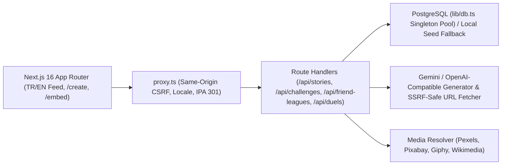

<div align="center">
  <a href="https://scrolly.live">
    
  </a>

  <h1>Scrolly</h1>

  <p>
    <strong>Kaydır · Öğren · Şaşır</strong> — İki dilli (TR/EN) dikey mikro-öğrenme, etkileşimli quiz, canlı düello ve No-Code Scrollytelling Studio platformu.
  </p>

  <p>
    <a href="https://scrolly.live">
      
    </a>
    <a href="https://scrolly.live/create">
      
    </a>
    
    
    
    <a href="./LICENSE">
      
    </a>
  </p>

  <p>
    <a href="#öne-çıkan-özellikler">Özellikler</a> ·
    <a href="#scrollytelling-studio-ve-embed">Studio & Embed</a> ·
    <a href="#mimari-ve-teknoloji-yığını">Mimari</a> ·
    <a href="#rota-ve-api-haritası">Rotalar & API</a> ·
    <a href="#hızlı-başlangıç">Kurulum</a> ·
    <a href="#ortam-değişkenleri">Ortam Değişkenleri</a>
  </p>
</div>

---

## Öne Çıkan Özellikler

| Modül | Açıklama | İlgili Rota |
| :--- | :--- | :--- |
| **Dikey Keşif Akışı** | Uzay, Doğa, İnsan Vücudu, Tarih, Bilim, Garip Rekorlar ve İstatistik alanlarında birincil bilimsel kaynaklı (`citation` / `isBasedOn`) iki dilli bilgi kartları. | [`/`](https://scrolly.live) · [`/en`](https://scrolly.live/en) |
| **Hızlı Tahmin & Günün Tahmini** | Slider veya çoktan seçmeli tahmin mekanizmasıyla anlık doğruluk yüzdesi, seri koruma ve XP ödülleri. | [`/gunluk/[tarih]`](https://scrolly.live) |
| **Word Lab (B1–C2)** | IPA fonetik gösterimi, normal/yavaş sesli telaffuz, iki dilli örnek cümleler ve anlık kelime testi. | [`/?category=vocabulary`](https://scrolly.live/?category=vocabulary) |
| **Quiz Merkezi & Asenkron Meydan Okuma** | Günlük Sprint, Haftalık Maraton, 5 kartlık Hafıza Quizi ve çözülen soruların snapshot'ını koruyan paylaşılabilir *"Beni Geçebilir Misin?"* bağlantıları. | [`/challenge/[code]`](https://scrolly.live) |
| **Scrolla 1v1 & Arkadaş Ligim** | 6 haneli oda koduyla canlı 1v1 bilgi düelloları, çoklu özel arkadaş/sınıf ligleri (max 10 lig) ve haftalık canlı XP sıralaması. | [`/duello/[code]`](https://scrolly.live) |
| **Scrollytelling Studio & Embed** | Herhangi bir makale URL'sini veya ham metni 5–7 kartlık Quick Guess içeren dikey deste hâline getirip her siteye `<iframe>` ile gömme. | [`/create`](https://scrolly.live/create) · `/embed/[id]` |
| **SEO + GEO & LLM Hazırlığı** | Çok dilli `canonical`/`hreflang`, Schema.org JSON-LD grafikleri, `llms.txt` / `llms-full.txt` ve otomatik `seo:audit` denetimi. | [`/llms.txt`](https://scrolly.live/llms.txt) · [`/sitemap.xml`](https://scrolly.live/sitemap.xml) |

---

## Scrollytelling Studio ve Embed

1. **[`/create`](https://scrolly.live/create)** ekranında bir makale URL'si (SSRF korumalı HTML metin temizleme) veya ham metin girilir.
2. `POST /api/stories/generate` yapılandırılmış LLM (`GEMINI_API_KEY` / `AI_API_KEY` / `OPENAI_API_KEY`) veya deterministik akıllı çıkarım ile **5–7 kartlık + her kartta 1 Quick Guess sorulu** deste üretir.
3. Sağdaki canlı önizleme üzerinde kart başlığı, metin, şıklar, tema (`Dark`/`Light`) ve vurgu rengi düzenlenir.
4. `POST /api/stories` ile kaydedildikten sonra tek tıkla kopyalanabilen `<iframe>` kodu oluşur ve **`/embed/[id]`** üzerinde navigasyon/reklam/banner olmadan izole oynatıcı (`frame-ancestors *`) sunulur.

---

## Mimari ve Teknoloji Yığını



- **Framework & UI:** Next.js 16.4 (App Router, Turbopack), React 19, TypeScript 5, Tailwind CSS 3, Framer Motion, Lucide Icons
- **Tasarım Sistemi:** *Çıkartma* semantik CSS token mimarisi (`app/globals.css`), WCAG AAA/AA kontrast doğrulaması (`tests/contrast.test.ts`), ESLint `cik/no-raw-palette` kuralı
- **Veri & Kalıcılık:** PostgreSQL (`pg` singleton pool, `max: 6` runtime / `2` build), advisory-lock şema yönetimi (`lib/db.ts`) ve veritabanı yokken yerel seed/memory fallback
- **Gözlemlenebilirlik:** Google Tag Manager, Microsoft Clarity (yalnızca production + CSP izinli) ve otomatik SEO/GEO audit (`scripts/seoAudit.mjs`)

---

## Rota ve API Haritası

<details>
<summary><strong>Tüm ana sayfaları ve REST uç noktalarını görüntüle</strong></summary>

| Yol | Yöntem | Amaç |
| :--- | :--- | :--- |
| `/` · `/en` | `GET` | Türkçe ve İngilizce dikey keşif akışı |
| `/fact/[slug]` · `/en/fact/[slug]` | `GET` | Tekil bilgi kartı detay, kaynak ve Schema.org sayfası |
| `/category/[category]` · `/en/category/[category]` | `GET` | Sayfalandırılmış kategori arşivleri |
| `/create` | `GET` | No-Code Scrollytelling Studio |
| `/embed/[id]` | `GET` | Üçüncü taraf siteler için izole iframe oynatıcı |
| `/challenge/[code]` | `GET` | Asenkron *"Beni Geçebilir Misin?"* quiz meydan okuması |
| `/duello/[code]` · `/en/duel/[code]` | `GET` | Scrolla 1v1 canlı bilgi düellosu |
| `/about`, `/contact`, `/privacy`, `/terms` | `GET` | Editöryal politika, FAQ (`40–60` kelime BLUF) ve yasal sayfalar |
| `/robots.txt`, `/sitemap.xml`, `/llms.txt`, `/llms-full.txt` | `GET` | Arama motoru ve yapay zeka indeksleri |
| `/api/stories/generate` | `POST` | URL/metinden AI veya akıllı çıkarımla kart destesi üretimi |
| `/api/stories` | `POST` | Hikâye kaydı (`{ id, embedUrl, iframeCode }`) |
| `/api/stories/[id]` | `GET` / `POST` | Hikâye getirme, görüntülenme & tamamlama sayacı |
| `/api/challenges` · `/api/challenges/[code]` | `POST` / `GET` | Soru snapshot'lı asenkron quiz meydan okuması |
| `/api/friend-leagues` · `leave` · `[code]` | `GET`/`POST`/`DELETE` | Çoklu özel arkadaş/sınıf ligleri |
| `/api/duels` · `/api/daily-guess` · `/api/leaderboard` | `GET`/`POST` | Canlı 1v1 odalar, günlük tahmin ve sıralamalar |

</details>

---

## Hızlı Başlangıç

**Gereksinim:** Node.js 22+

```bash
npm ci
npm run dev
```

Uygulama varsayılan olarak [`http://localhost:3000`](http://localhost:3000) adresinde açılır (`DATABASE_URL` tanımlı değilse `public/data/facts` tohum verisi ve bellek içi mağazalarla sıfır kurulumla çalışır).

### Doğrulama & Otomasyon Komutları

```bash
npm run lint              # ESLint + cik/no-raw-palette denetimi
npm run test:contrast     # 34 adet ışık/karanlık tema WCAG kontrast testi
npx tsc --noEmit          # Katı TypeScript tip kontrolü
npm run build             # Üretim derlemesi (Next.js App Router)
npm run seo:audit         # Canlı veya --base-url üzerinde 100 adımlı SEO + GEO denetimi
npm run generate-facts    # Günlük kart ve medya üretim hattı (Scheduler)
```

> **Veritabanı Migration:** `stories` tablosu hem uygulama açılışında `ensureSchema()` ile otomatik oluşturulur hem de manuel çalıştırma için [`migrations/001_create_stories.sql`](./migrations/001_create_stories.sql) dosyasında yer alır.

---

## Ortam Değişkenleri

Değerleri yalnızca yerelde `.env.local` içine veya barındırma ortamına (Heroku Config Vars) ekleyin; repoya gizli anahtar koymayın.

| Grup | Değişken | Zorunluluk | Açıklama |
| :--- | :--- | :---: | :--- |
| **Çekirdek** | `DATABASE_URL` | Üretimde | PostgreSQL bağlantı dizesi (yerelde boş bırakılabilir) |
| **Güvenlik** | `AUTH_SECRET` | Üretimde | OTP, oturum ve imzalı cihaz/aktör çerezleri (`>= 32` karakter) |
| **AI Üretim** | `GEMINI_API_KEY` | İsteğe bağlı | `generate-facts` ve `/api/stories/generate` (`AI_API_KEY` / `OPENAI_API_KEY` de desteklenir) |
| **Medya** | `PEXELS_API_KEY`, `PIXABAY_API_KEY`, `GIPHY_API_KEY` | İsteğe bağlı | Video/GIF eşleştirme kaynakları (Wikimedia anahtar gerektirmez) |
| **E-posta** | `RESEND_API_KEY`, `EMAIL_FROM`, `CONTACT_RECEIVER_EMAIL` | Üretimde | Şifresiz OTP girişi ve iletişim bildirimleri |
| **Analitik** | `NEXT_PUBLIC_CLARITY_ID`, `NEXT_PUBLIC_GTM_ID` | İsteğe bağlı | Microsoft Clarity ve Google Tag Manager kimlikleri |

---

## Güvenlik ve Kalite İlkeleri

- **CSP & Framing İzolasyonu:** `/embed/*` haricindeki tüm rotalarda `X-Frame-Options: DENY` ve `Content-Security-Policy: frame-ancestors 'none'`; `/embed/[id]` için yalnızca `frame-ancestors *` izni.
- **CSRF & Rate Limiting:** Yazma uç noktalarında `proxy.ts` + `enforceSameOrigin` (`lib/originPolicy.ts`), boyut sınırlı JSON okuyucu (`readJsonBodyWithLimit`) ve IP bazlı bellek içi rate limit (`lib/rateLimit.ts`).
- **SSRF Koruması:** `/api/stories/generate` ve `/api/media-proxy` içinde özel/yerel IP bloklaması (`isBlockedMediaHost`) + DNS çözünürlüğü kontrolü (`dns.lookup(..., { all: true })`).

---

## Lisans ve İletişim

- **Lisans:** [MIT](./LICENSE)
- **Web:** [https://scrolly.live](https://scrolly.live) · **İletişim:** `contact@scrolly.live`
